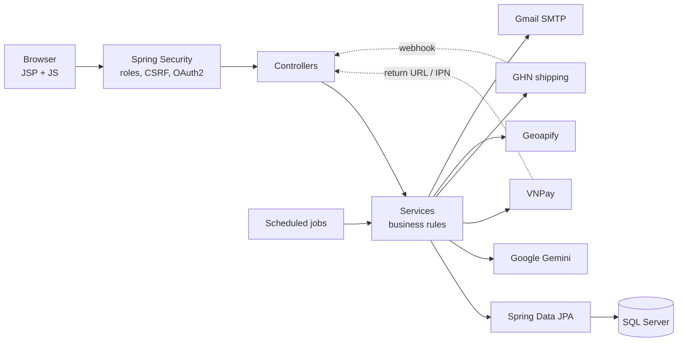
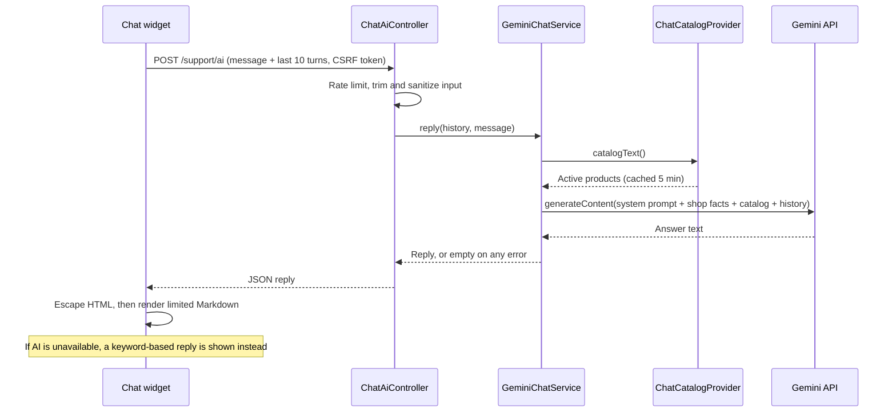

# 🐾 PetFood Shop
 


 
A full-stack e-commerce platform for pet food, built around one real-world problem: **pet food expires**.
 
The system tracks every stock lot by expiry date, ships the earliest-expiring safe stock first (FEFO), moves near-expiry lots into automatically priced Flash Sales, and refuses to sell anything too close to its expiry date. Customers also get an **AI shopping assistant** powered by Google Gemini that recommends products from the live catalog.
 
> Team project for the ISP392 course at FPT University HCMC (Group 3, 2026).
 
---
 
## Highlights
 
- **Expiry-aware inventory** – stock is managed per lot; FEFO allocation at checkout; low-stock and near-expiry alerts for staff.
- **Automatic Flash Sales for near-expiry stock** – discount is calculated from each lot's remaining shelf life; campaigns open and close on schedule.
- **AI shopping assistant** – Gemini answers customer questions using the real product catalog and shop policies, with guardrails against off-topic questions, prompt injection and made-up products.
- **Real payment and shipping integrations** – VNPay (sandbox) with signed callbacks, GHN shipping with waybills and webhooks, distance-based shipping fees via Geoapify.
- **Complete order lifecycle** – cart → checkout → confirm → pack → ship → complete, plus cancellations, returns with photo evidence, inspection and refunds.
- **Three roles** – Customer, Staff and Admin, each with its own pages and permissions.
## Tech stack
 
| Layer | Technologies |
|---|---|
| Backend | Java 21, Spring Boot 4.1 (Web MVC, Data JPA / Hibernate, Security, OAuth2 Client, Mail, Validation), Lombok |
| Frontend | JSP + JSTL, Spring form tags, vanilla JavaScript, CSS |
| Database | Microsoft SQL Server |
| Integrations | Google Gemini API, VNPay, GHN (Giao Hàng Nhanh), Geoapify geocoding, Google Sign-In, Gmail SMTP |
| Build | Maven (wrapper included), packaged as WAR with embedded Tomcat |
 
## Architecture
 
Layered Spring MVC application: controllers handle HTTP, services hold the business rules, repositories talk to SQL Server through JPA. Scheduled jobs run time-based rules such as payment timeouts and Flash Sale windows.
 

 
## Features
 
### Customer
- Browse and filter products by keyword, category, species, age group, brand and price
- Product pages with image gallery, stock, nearest expiry date and reviews
- Cart, checkout with COD or VNPay, shipping fee quote by address
- Order history and tracking, cancellation requests
- Return requests within 3 days of delivery, with 1–5 photos or videos
- Product reviews for purchased items
- Membership tiers (Bronze / Silver / Gold / Diamond) with automatic discounts
- Sign up with email or Google, password reset by email OTP
- AI chat assistant, a guided help center and support tickets
### Staff
- Manage categories, products (up to 5 images each) and stock lots
- Inventory alerts: low stock and near-expiry lots
- Process orders step by step, create GHN waybills, handle cancellation requests
- Inspect returns line by line and record refunds
- Moderate and reply to reviews
- Edit the help center's question tree
### Admin
- Everything Staff can do
- Sales dashboard with date-range filter
- Manage employees: create, edit, reset password, lock or unlock (locking ends the employee's active sessions immediately)
- Create and control Flash Sale campaigns
- Recalculate membership tiers on demand
## AI shopping assistant
 
A chat widget on every storefront page. Quick topics return instant answers; free-text questions go to Google Gemini.
 

 
**How it stays accurate.** Every request carries a system prompt containing the shop's policies (shipping, returns, payments, membership) and the current list of products for sale, with name, brand, size, target pet, price and product link. The model is instructed to recommend only products from that list and to link to them.
 
**Guardrails**
- **Scope:** answers only questions about pet nutrition, pet care and the shop; politely declines everything else.
- **Prompt injection:** refuses to reveal its instructions, database structure, keys or internal data, and ignores jailbreak attempts.
- **No hallucinated products:** may only suggest real products at their real prices; no invented discounts or vouchers.
- **Safety:** does not diagnose illness; tells owners to see a vet for serious symptoms. Order lookups and complaints are redirected to the order page or a support ticket.
- **Abuse and cost control:** 15 messages per 5 minutes per session; message and history length are capped.
- **Safe rendering:** the reply is HTML-escaped before Markdown is applied, and only internal relative links are turned into anchors, which blocks injected scripts and links to outside sites.
- **Graceful degradation:** missing key, quota errors or timeouts fall back to rule-based replies, so the chat never breaks.
The API key is read from `.env` and only used server-side; it never reaches the browser.
 
## Under the hood
 
### Inventory and expiry rules
 
| Remaining shelf life of a lot | How it can be sold |
|---|---|
| 90 days or more | Regular price |
| 30–89 days | Flash Sale only, 40% off |
| 21–29 days | Flash Sale only, 70% off |
| Under 21 days | Not sold |
 
All thresholds and discounts are configurable in `application.properties`.
 
- **FEFO allocation:** at checkout, quantity is taken from the lots that expire first. Each deducted lot is recorded per order line, so a cancellation returns stock to exactly the same lots.
- **No overselling:** each stock deduction is a conditional `UPDATE` that only succeeds if enough quantity remains. If another order takes the stock first, the service re-reads and retries; if stock runs out, the whole order rolls back and the cart is left untouched.
- **Row locking** on orders and return requests prevents two staff members from changing the same record at once.
### Payments (VNPay)
- Payment links and callbacks are signed with **HMAC-SHA512**; incoming signatures are verified with a constant-time comparison before any data is trusted.
- Stock is held for 15 minutes while the customer pays. When the hold expires, a scheduled job **queries VNPay for the transaction status** before cancelling, so a paid order is never cancelled by mistake.
- Unconfirmed COD orders are cancelled automatically after 24 hours.
### Shipping (GHN)
- Staff create GHN waybills from the order page.
- The webhook endpoint can be locked with a shared secret header, and the shipment status is **re-fetched from the GHN API** instead of trusting the webhook payload.
- Shipping fee: free within 5 km of the store for orders from 150,000 VND, otherwise a flat 30,000 VND. Addresses are geocoded with Geoapify.
### Security
- Role-based access control on every URL; Google Sign-In is limited to customers.
- Passwords and OTP codes are stored as BCrypt hashes.
- Password reset OTP: 6 digits from `SecureRandom`, valid 10 minutes, 5 wrong attempts invalidate it, resend throttling, and identical responses whether or not an email is registered (no account enumeration).
- CSRF protection on all POST requests; user-generated text is escaped in views to prevent XSS.
- Uploaded images are validated by their actual content (not extension or Content-Type), corrected for EXIF orientation, resized and re-encoded as JPEG.
- Error pages never expose stack traces or exception messages.
- Secrets live in a git-ignored `.env` file.
## Getting started
 
### Requirements
- JDK 21
- SQL Server on `localhost:1433`
- Maven is not required (the Maven Wrapper is included)
### 1. Database
Run the setup script `FoodPetShop_FullSetup.sql` in SSMS or Azure Data Studio. It creates the `FoodPetShop` database with all tables and sample data (accounts, products with images, stock lots, help-center content). The script is not included in this repository; it is available on request.
 
The app validates the schema on startup and stops if a table or column is missing.
 
### 2. Configuration
Create a `.env` file in the project root (next to `pom.xml`):
 
```properties
DB_PASSWORD=your_sa_password
```
 
This is enough to run the app. Optional integrations are switched on by adding their keys; each feature degrades gracefully when its key is missing:
 
| Keys in `.env` | Enables | Without it |
|---|---|---|
| `petfood.gemini.api-key` | AI chat assistant | Rule-based chat replies |
| `petfood.vnpay.tmn-code`, `petfood.vnpay.hash-secret` | VNPay payment (sandbox) | COD only |
| `petfood.ghn.token`, `petfood.ghn.shop-id`, `petfood.ghn.webhook-secret` | GHN waybills and tracking | Manual shipping status |
| `petfood.geocoding.geoapify-api-key` | Distance-based shipping fee | Flat 30,000 VND fee |
| `spring.mail.username`, `spring.mail.password` | OTP and support emails | Emails marked as failed, can be resent later |
| `spring.security.oauth2.client.registration.google.client-id`, `...client-secret` | Sign in with Google | Google button hidden |
 
### 3. Run
 
```bash
./mvnw spring-boot:run      # macOS / Linux
mvnw.cmd spring-boot:run    # Windows
```
 
Run from the project root, then open http://localhost:8080. Demo accounts for each role (Admin, Staff, Customer) are created by the setup script.
 
## Project structure
 
```
src/main/
├── java/com/isp392/petfood/
│   ├── config/        Security, web and scheduling configuration
│   ├── controller/    MVC controllers, REST endpoint for AI chat, payment and webhook callbacks
│   ├── service/       Business logic, scheduled jobs, external API clients
│   ├── repository/    Spring Data JPA repositories
│   ├── entity/        JPA entities
│   ├── dto/           View models and form objects
│   ├── enums/         Statuses, roles, tiers
│   └── exception/     Business and not-found exceptions
├── resources/
│   ├── application.properties
│   └── static/        CSS and product images
└── webapp/WEB-INF/views/   JSP pages (customer, staff, admin, auth, support)
```
 
## Team
 
Built by ISP392 Group 3 at FPT University HCMC.
Backend (Spring Boot, database design, payment, shipping and AI integrations) by **Tran Anh Khoa** – [@khoadauvang](https://github.com/khoadauvang).
